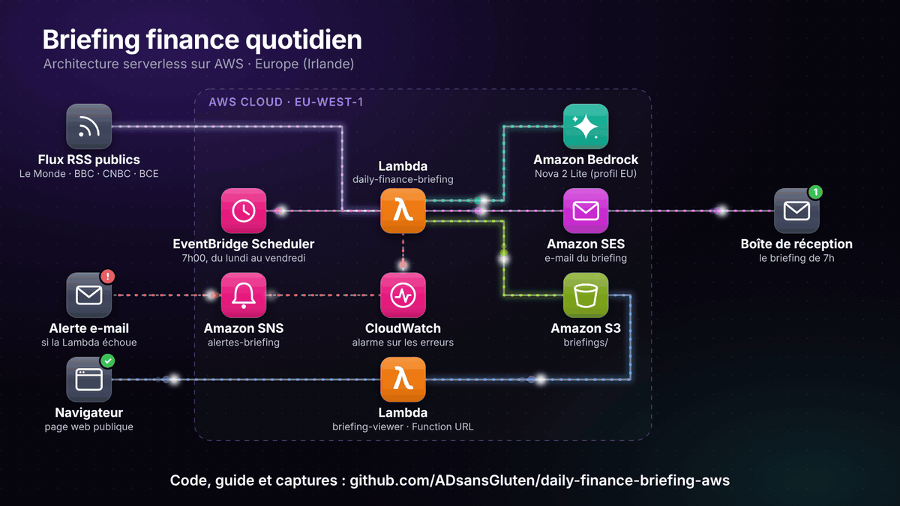
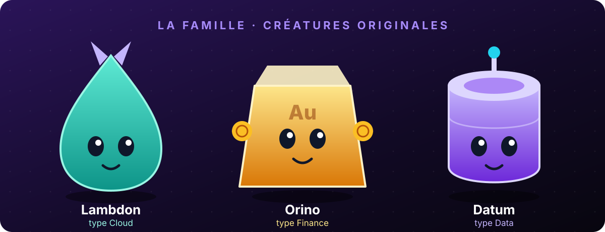

  

## À propos

Étudiant en Bachelor Data & Intelligence Artificielle à **Ynov Campus Sophia**. Je m'intéresse beaucoup à la finance, et j'essaie de relier ce domaine à mon parcours en data et en IA à travers des projets concrets.

- Badge **AWS Educate - Introduction to Cloud 101** (novembre 2026)
- Je prépare la certification **Fortinet NSE 1**
- Je travaille en Python, et j'apprends le cloud AWS et le développement web

## Projet à la une : briefing finance quotidien

Chaque matin en semaine, un e-mail me résume l'actualité financière (Le Monde, BBC, CNBC, BCE), avec les sources citées. Le tout tourne sur AWS, sans serveur à gérer.

  

**EventBridge Scheduler → Lambda → Amazon Bedrock → S3 + SES**, avec une page web publique et une alerte CloudWatch + SNS.

[Voir le code et le guide pas à pas](https://github.com/ADsansGluten/daily-finance-briefing-aws)

## Prochain projet : la volatilité de l'or

  

Je prépare une plateforme cloud automatisée sur AWS qui prédit la volatilité de l'or (XAUUSD). La question de départ : le machine learning fait-il mieux que le modèle classique GARCH(1,1) ? Je veux la traiter proprement, avec un découpage strict des données dans le temps pour éviter les fuites d'information.

## Mon équipe

  

- **Lambdon** (type Cloud) : il veille sur mes projets AWS, comme le [briefing finance quotidien](https://github.com/ADsansGluten/daily-finance-briefing-aws).
- **Orino** (type Finance) : il garde le projet sur la volatilité de l'or (XAUUSD).
- **Datum** (type Data) : il range les données et prépare les modèles.

  

## Outils

